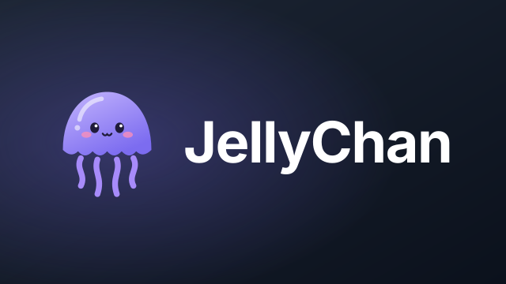
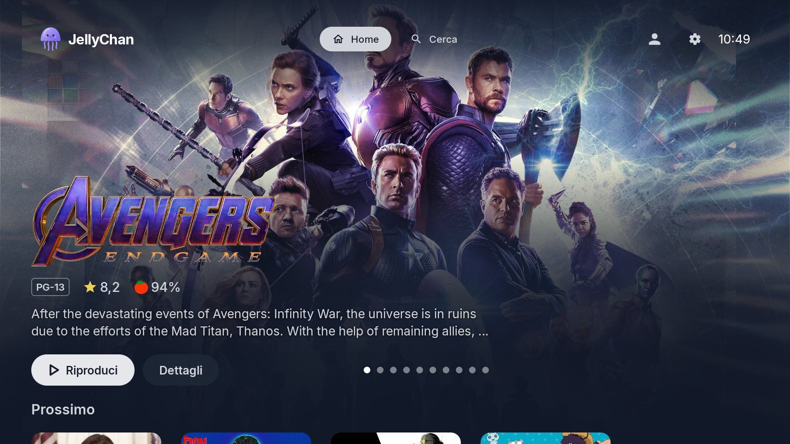
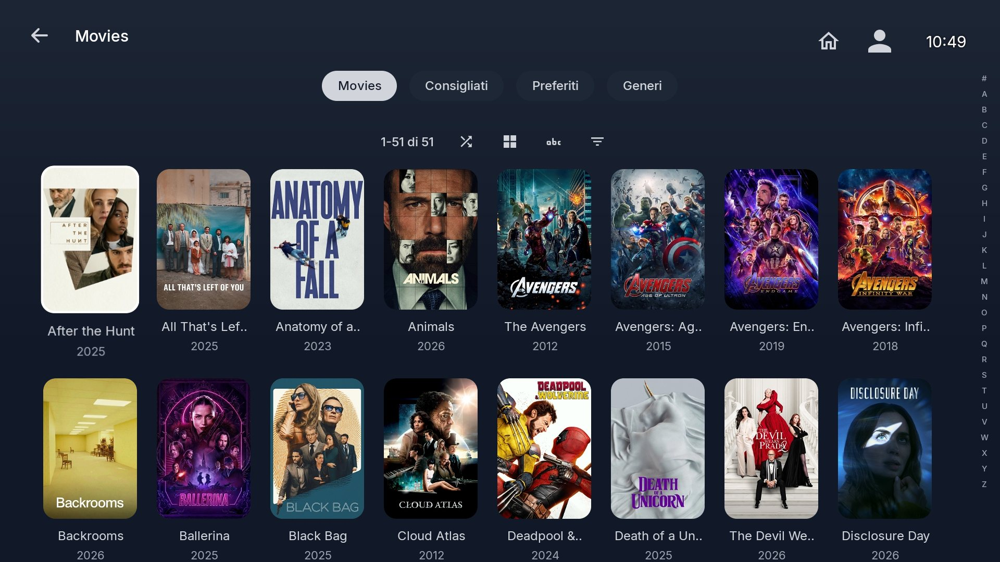
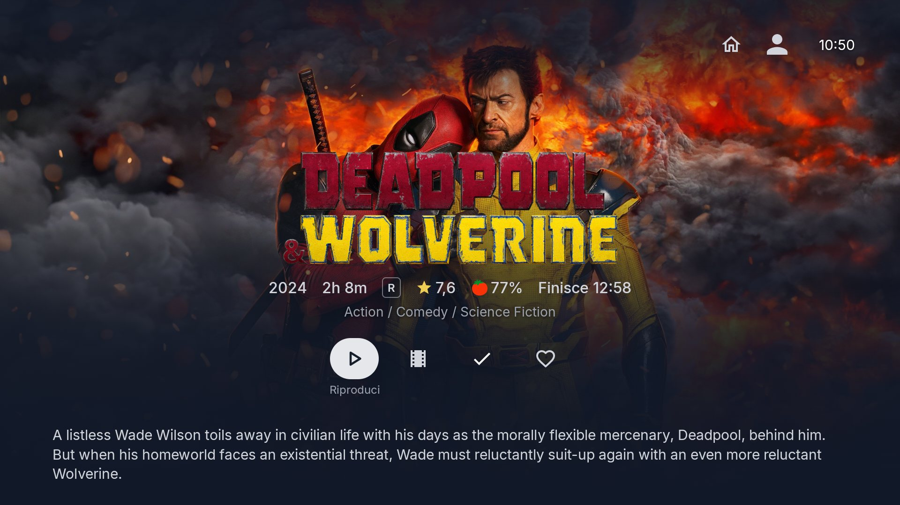
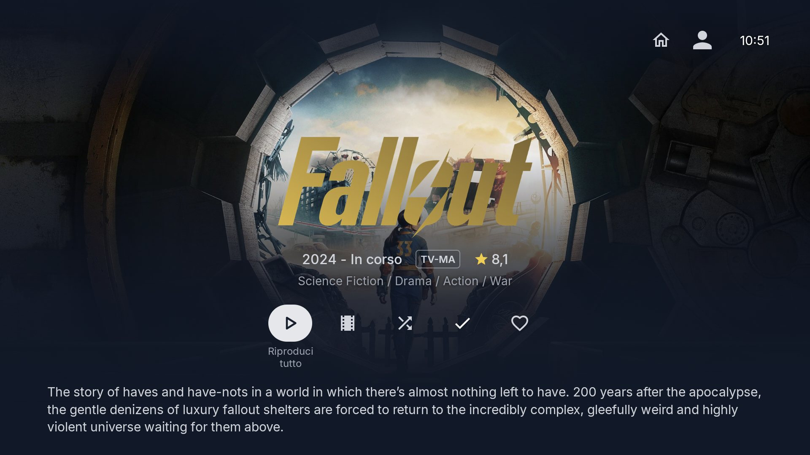
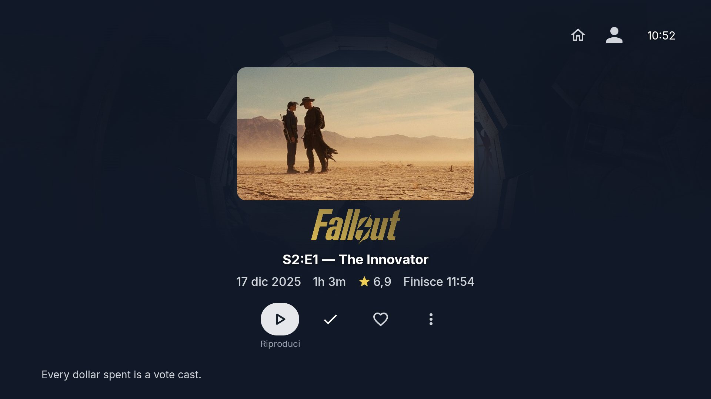
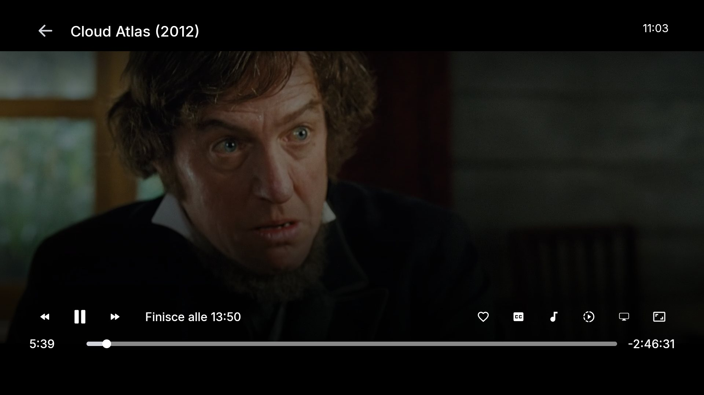
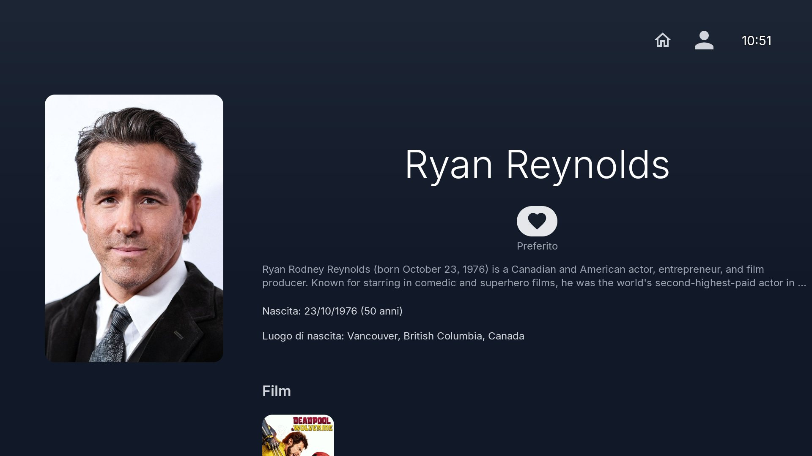

<p align="center">

</p>

<h3 align="center">An elegant Android TV and Fire TV client for Jellyfin</h3>

<p align="center">
<a href="LICENSE"></a>

</p>

---

JellyChan is an unofficial client for [Jellyfin](https://jellyfin.org) media servers, built for Android TV and
Amazon Fire TV. It is a fork of the official
[Jellyfin for Android TV](https://github.com/jellyfin/jellyfin-androidtv) app with a redesigned interface:
dark navy palette, Inter typography, rounded cards and pill buttons, and a cinematic layout for home,
item pages and the player.

> **JellyChan is not affiliated with or endorsed by the Jellyfin project.** "Jellyfin" is used here only to
> describe compatibility. You need your own Jellyfin server to use the app.

> **AI disclosure: JellyChan is primarily LLM-developed.** All changes on top of the upstream app were written
> with [Claude](https://claude.ai), Anthropic's AI. The upstream code remains the work of the Jellyfin
> contributors.

## Features

- **Home** — full-screen spotlight carousel with random movies and series, backdrop and muted local
  trailer, followed by Next up, Continue watching and My media rows.
- **Item pages** — full backdrop with centered clear logo, metadata, actions and overview; compact episode
  header with thumbnail.
- **Cast & crew** — round photos; person page with fixed portrait and scrolling biography and filmography.
- **Library** — tabs (Library, Suggested, Favorites, Genres), shuffle, sort and filters, A–Z quick index,
  8-column poster grid.
- **Player** — single-line controls, previous/next episode, favorite toggle, subtitles and audio always
  visible, trickplay preview on seek, remaining time and end time.

## Screenshots

<p align="center">

<br/><em>Home</em>
</p>

<table>
<tr>
<td width="50%" align="center"><br/><em>Movie library</em></td>
<td width="50%" align="center"><br/><em>Movie page</em></td>
</tr>
<tr>
<td width="50%" align="center"><br/><em>TV show page</em></td>
<td width="50%" align="center"><br/><em>Episode page</em></td>
</tr>
<tr>
<td width="50%" align="center"><br/><em>Player</em></td>
<td width="50%" align="center"><br/><em>Cast detail</em></td>
</tr>
</table>

## Install

JellyChan is currently distributed as an APK only.

1. Download the latest `jellychan-v*.apk` from [Releases](../../releases).
2. Sideload it on your device (on Fire TV, for example, with the *Downloader* app or `adb install`).
3. Open JellyChan, enter your server address and sign in (password or Quick Connect).

Requirements: Android 5.0 (API 21) or newer, Jellyfin server 10.10 or newer.

## Versioning

JellyChan follows [Semantic Versioning](https://semver.org). Pre-releases are tagged `vX.Y.Z-alpha.N` and
`vX.Y.Z-beta.N`. The version is set by `jellychan.version` in `gradle.properties`; see
[CHANGELOG.md](CHANGELOG.md) for what changed in each release.

## Building

```sh
./gradlew assembleDebug        # debug build, installs next to a release build
./gradlew assembleRelease      # release build (signing via KEYSTORE_* environment variables)
```

The APK is written to `app/build/outputs/apk/`. JDK 21 and the Android SDK are required.

## Credits

- Based on [Jellyfin for Android TV](https://github.com/jellyfin/jellyfin-androidtv) by the Jellyfin
  contributors (see [CONTRIBUTORS.md](CONTRIBUTORS.md)). The internal Kotlin package keeps the upstream
  name `org.jellyfin.androidtv` to make merging upstream changes easier.
- Visual design inspired by [ElegantFin](https://github.com/lscambo13/ElegantFin), a Jellyfin web theme
  by lscambo13. No code from ElegantFin is included.
- Uses the [Jellyfin Kotlin SDK](https://github.com/jellyfin/jellyfin-sdk-kotlin) and the
  [Inter](https://rsms.me/inter/) typeface (SIL Open Font License).

## License

JellyChan is free software released under the [GNU General Public License v2.0](LICENSE), the same license as
the upstream project.
